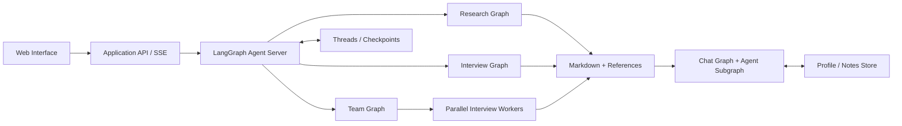

<div align="center">

# Research Assistant

### От сложного вопроса — к отчёту с источниками.

Исследовательский workspace с AI-аналитиками, управляемым поиском<br>и обсуждением результатов с сохранением контекста.


[Возможности](#возможности) · [Архитектура](#архитектура) · [Запуск](#запуск) · [Документация](#документация)

</div>

---

**Research Assistant** помогает исследовать технические темы: согласовать направление, собрать источники, сопоставить выводы и сохранить результат в Markdown. Пользователь контролирует план и роли аналитиков до начала поиска, а затем может обсуждать конкретный отчёт, продолжать прерванные запуски и сравнивать альтернативные варианты исследования.

## Возможности

| Сценарий | Результат |
| :--- | :--- |
| **Исследование по плану** | Редактируемый план, параллельный поиск по разделам и отчёт с References. |
| **Интервью с экспертом** | Два раунда вопросов и ответов по найденным материалам, Transcript и общий вывод. |
| **Команда аналитиков** | Две редактируемые роли, параллельные интервью и синтез с общим реестром источников. |
| **Обсуждение отчёта** | Диалог, привязанный к завершённому Research Checkpoint, с инструментами чтения сохранённых источников. |
| **Память пользователя** | Profile и Notes между диалогами; запись по явному запросу, просмотр и удаление данных. |
| **История и варианты** | Checkpoints, Resume, Replay и Fork с отдельными артефактами отчётов. |

### Контроль выполнения

- **Human-in-the-Loop:** утверждение, редактирование и отмена плана или ролей через `interrupt()`.
- **Восстановление:** сохранение состояния между процессами и подключение к Run после обновления страницы.
- **Прозрачность:** Progress Events и Streaming показывают ход работы; итоговый результат сохраняется отдельно.
- **Проверяемые ссылки:** модель оперирует ID источников; приложение проверяет ID и формирует Markdown-ссылки программно.
- **Управляемый контекст:** полная история хранится в Checkpoints, вход модели собирается через Filter, Trim и incremental Summary.

## Архитектура



**LangGraph управляет жизненным циклом исследования.** `StateGraph` задаёт переходы и паузы, `Send` распределяет независимые задачи, Reducers объединяют результаты, а Checkpoints позволяют продолжать выполнение. Interview Core переиспользуется самостоятельным интервью и Worker-ветками команды.

**Web-слой отвечает за пользовательский сценарий.** Starlette BFF связывает запросы с Run IDs, передаёт безопасные события через SSE, проверяет принадлежность данных и восстанавливает неподтверждённые запросы. Browser UI написан на JavaScript и CSS без отдельной сборки frontend.

**Диалог отделён от исследования.** Parent Chat Graph хранит историю и Summary; Agent Subgraph выполняет один вопрос через `bind_tools` и `ToolNode`. Привязка к точному Checkpoint сохраняет контекст выбранного результата при появлении новых веток.

| Компонент | Технологии |
| :--- | :--- |
| Workflow и агенты | LangGraph, LangChain Core, LangChain OpenAI |
| Структурированные ответы | Pydantic, JSON Schema |
| Модель и поиск | Польза AI — OpenAI-compatible API; Tavily |
| Web и Streaming | Starlette, Uvicorn, LangGraph SDK, SSE |
| Хранение | Native Agent Server Persistence, SQLite Checkpointer и Store |
| Проверки | `unittest`, HTTP-сценарии, проверки перезапуска и восстановления |

## Запуск

Основной локальный сценарий — **Windows PowerShell и Python 3.12**. Пакет поддерживает Python 3.11+, готовые launchers предназначены для Windows.

### Установка

```powershell
git clone https://github.com/KatnikovAA/LangGraph.git
Set-Location LangGraph
py -3.12 -m venv .venv-web
.\.venv-web\Scripts\python.exe -m pip install -r requirements-web.lock -e '.[web]'
Copy-Item .env.example .env
```

Заполните `.env` на сервере:

```dotenv
POLZA_API_KEY=your_api_key
POLZA_MODEL=your_model_id
POLZA_BASE_URL=https://polza.ai/api/v1/
TAVILY_API_KEY=your_api_key
```

Модель выбирается явно через `POLZA_MODEL`. Ключи и локальные данные исключены из Git.

### Web-приложение

```powershell
.\scripts\start-web.ps1 -Mode live
Start-Process 'http://127.0.0.1:8080'
```

Введите тему, выберите обычное исследование, одно интервью или команду аналитиков. Проверьте план или роли, получите отчёт и перейдите к его обсуждению.

| Адрес | Назначение |
| :--- | :--- |
| `http://127.0.0.1:8080` | Пользовательский интерфейс |
| `http://127.0.0.1:8080/ready` | Готовность и текущий режим |
| `http://127.0.0.1:2025/docs` | API Agent Server |

Остановка: `.\scripts\stop-web.ps1 -Mode live`. Не запускайте второй экземпляр поверх работающего.

> [!NOTE]
> Live обращается к модели и Tavily: стоимость зависит от провайдеров. Для автономной проверки доступен явный `-Mode demo` с детерминированными ответами и отдельным каталогом данных. Он не подтверждает качество модели или реального поиска.

### CLI

```powershell
# План исследования
.\.venv-web\Scripts\python.exe -m research_assistant --topic 'Архитектура событийных систем'

# План → подтверждение → поиск → отчёт
.\.venv-web\Scripts\python.exe -m research_assistant --topic 'Архитектура событийных систем' --review --search --report
```

Сценарии Resume, Checkpoints и отдельных экземпляров — в [руководстве по эксплуатации](docs/operations.md).

## Устройство репозитория

```text
research_assistant/
├── graph.py                 # Research Workflow и параллельный поиск
├── reporting.py             # References и атомарная запись Markdown
├── chat*.py                 # Диалог, контекст и Streaming
├── user_memory.py           # Profile / Notes и изоляция данных
├── interview/               # Analyst / Expert и общий Interview Core
├── team/                    # Review ролей, Workers и синтез
├── web/                     # BFF, SSE, восстановление и интерфейс
└── server_*.py              # Graph entrypoints, настройки и Store lifecycle
scripts/                     # Локальный запуск и SDK-примеры
tests/                       # Автономные и opt-in интеграционные проверки
```

## Проверки

```powershell
.\.venv-web\Scripts\python.exe -m unittest discover -s tests -v
.\.venv-web\Scripts\python.exe -m compileall -q research_assistant tests scripts
.\.venv-web\Scripts\python.exe -m pip check
```

Основной набор использует подмены модели и поиска. HTTP, restart и clean-checkout проверки включаются отдельно в изолированном окружении; команды и предусловия — в [документации](docs/operations.md#проверки).

## Границы применения

- Приложение рассчитано на локальный запуск: серверы слушают loopback. `user_id` разделяет данные, но не заменяет аутентификацию.
- Отчёты основаны на snippets поиска. Полные страницы не загружаются; ссылка не гарантирует фактическую точность вывода модели.
- Checkpoints сохраняют успешные результаты, однако незавершённый внешний вызов при Resume может повториться. Exactly-once не гарантируется.
- Оценка контекста приблизительная. Structured output и token streaming зависят от выбранной модели.
- Публичный хостинг, авторизация и production-инфраструктура требуют отдельной настройки.

## Документация

- [Архитектура и решения](docs/architecture.md)
- [Запуск, данные и проверки](docs/operations.md)
- [Interview Workflow](research_assistant/interview/README.md)
- [Команда аналитиков](research_assistant/team/README.md)
